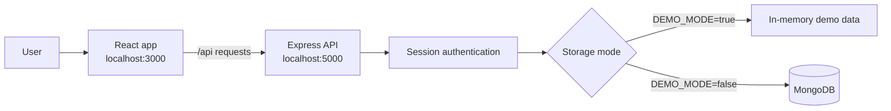
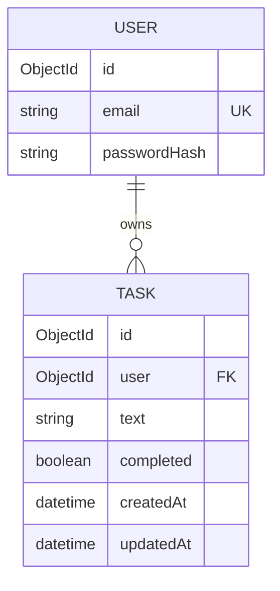

# ToDo List

This app uses React for the UI and an Express/Node.js API. It can use MongoDB
for persistent accounts, sessions, and tasks, or an in-memory demo mode to
show the app without installing MongoDB. Passwords are hashed, and sign-in
uses an HTTP-only session cookie.

## Architecture



## Data Model



## Run a demo without MongoDB

From this project folder, install dependencies and create `.env` if needed:

```powershell
npm install
Copy-Item .env.example .env
```

Set `DEMO_MODE=true` in `.env` and set `SESSION_SECRET` to a private value of
at least 32 characters, then start the app:

```powershell
npm run dev
```

Open [http://localhost:3000](http://localhost:3000) and log in using:

- Email: `todo.demo@example.com`
- Password: `TodoDemo123!`

You can also create an account using **Sign up**. Demo accounts, sessions, and
tasks are held in memory and are cleared when the API server restarts. Use
MongoDB mode below when data needs to persist.

## Run with MongoDB

1. Install Node.js and MongoDB, or create a MongoDB Atlas database.
2. Set `DEMO_MODE=false` in `.env`, set `MONGO_URI` to your MongoDB connection
   string, and make sure MongoDB is running.
3. Keep `PORT=3000` for React and `API_PORT=5000` for Express. Keep `.env`
   private; it is ignored by Git.
4. Start the Node API and React app together:

   ```powershell
   npm run dev
   ```

5. Open [http://localhost:3000](http://localhost:3000). Create an account, then
   add tasks. Tasks are saved to MongoDB and are only available to their owner.

The React development server runs on port 3000, and the Express API runs on
port 5000. The React development server proxies `/api` requests to Express.
If you change `API_PORT`, also update the `proxy` value in `package.json`.

